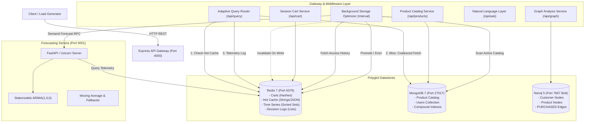

# Intelligent Polyglot Data Platform & Adaptive Cache Engine

A high-performance polyglot persistence platform integrating **Redis** (in-memory key-value), **MongoDB** (document store), and **Neo4j** (graph database) behind an Express API gateway, powered by an **adaptive caching engine** and a **FastAPI forecasting microservice**.

---

## 1. Problem Statement & Core Architectural Motivation

Modern e-commerce and high-throughput data platforms handle disparate data models with fundamentally conflicting access characteristics:
- **Fast-path session & telemetry data**: Requires sub-millisecond atomic mutations, rolling access logs, and volatile cache storage.
- **Hierarchical product catalog data**: Requires flexible schemas for category-specific attributes (e.g., screen size for electronics, fabric for apparel) and multi-field compound indexing.
- **Social & co-purchase graph relations**: Requires traversals across multi-hop relationships (`Customer -> Purchased -> Product`) that cause combinatorial explosion when implemented via relational `JOIN`s or document embedding.

A single general-purpose database forced to serve all three access patterns incurs severe trade-offs in throughput, query complexity, and scalability. This platform implements **Polyglot Persistence**, assigning each domain workload to its optimal datastore while unifying access behind an intelligent, adaptive caching gateway.

---

## 2. Polyglot Datastore Responsibility Matrix

| Datastore | Engine | Storage Model | Primary Workload | Performance & Access Characteristics |
|:---|:---|:---|:---|:---|
| **Redis** | Key-Value / Sorted Sets | In-Memory Data Structures | - User Carts (`cart:{id}`)<br>- Hot Product Cache (`cache:product:{id}`)<br>- Access Telemetry (`access:history:{id}`)<br>- Routing & Optimizer Audit Trails | Sub-millisecond reads/writes; atomic Lua scripting for bucketed telemetry aggregation; native TTL eviction. |
| **MongoDB** | Document Store | BSON Documents | - Master Product Catalog (`products`)<br>- Customer Directory (`users`) | Flexible sub-document `attributes`; secondary compound indexes (`{category: 1, price: 1}`); single-flight query coalescing. |
| **Neo4j** | Labeled Property Graph | Directed Property Graphs | - Purchase Relationships (`:PURCHASED`)<br>- Co-purchase Graph Recommendations | Native index-free adjacency; multi-hop graph traversal; idempotent write transactions (`MERGE`). |

---

## 3. High-Level Architecture & Request Flows



### Core Request Flows

1. **Adaptive Read Path (`GET /api/query/product/:id`)**:
   - Checks Redis hot cache (`cache:product:${id}`).
   - **Cache Hit**: Returns JSON directly (< 2ms latency), records telemetry event.
   - **Cache Miss**: Coalesces concurrent misses via **Single-Flight** promise deduplication to prevent database stampedes, falls back to MongoDB, logs access event to Redis sorted set (`access:history:${id}`).
2. **Adaptive Optimization Loop**:
   - Runs periodically (configurable, e.g. every 30s) under bounded concurrency.
   - Decouples **lifetime request counts** from **recent-window demand** (e.g. last 5 minutes).
   - Queries Python forecasting microservice for next-window projected arrival rates.
   - **Promotion**: If predicted demand $\ge$ `promoteThreshold` (or recent burst) and not cached, primes Redis with configured TTL.
   - **Demotion**: If product is cached, recent window demand $\le$ `demoteThreshold`, and forecast $< \text{threshold}$, evicts key from Redis.
3. **Graph Recommendation Path (`GET /api/graph/products/:id/recommendations`)**:
   - Traverses co-purchase patterns: `MATCH (p1)<-[:PURCHASED]-(c)-[:PURCHASED]->(p2) WHERE p1 <> p2 RETURN p2.id, count(DISTINCT c)`.
4. **Natural Language GenAI Path (`POST /api/ask`)**:
   - Dispatches user intent to LLM provider (OpenAI, Anthropic, or Mock engine).
   - Strictly validates structured output against JSON schema; enforces MongoDB read-only allowlist (`store: mongodb`, `operation: find`).

---

## 4. Cache Policy, Consistency Model & Trade-Offs

### Consistency Model
- **Catalog Writes (`PUT / POST / DELETE /api/products`)**: Operates on a **Cache-Invalidation on Mutation** model. Any update or deletion directly mutates MongoDB and issues an immediate `DEL cache:product:${id}` to Redis.
- **Read-Path Consistency**: Eventual consistency bounded by the cache TTL (`OPTIMIZER_CACHE_TTL_SECONDS = 300s`) or explicit mutation invalidation.
- **Cache Stampede Protection**: Employs an in-memory single-flight coalescing mechanism that multiplexes concurrent cache misses for the same key onto a single active MongoDB promise.

### Comparative Strategy Trade-Off Analysis

| Strategy | Advantages | Trade-Offs & Failure Modes |
|:---|:---|:---|
| **Baseline A: No Application Cache** | - Zero cache invalidation complexity.<br>- Immediate, strict consistency on every read. | - High database read volume and latency spikes.<br>- Limited throughput capacity under load. |
| **Baseline B: Conventional Cache-Aside (Fixed TTL)** | - High raw hit ratio for static workloads.<br>- Fast reactive priming on miss. | - **Cache Pollution**: One-hit-wonder products consume memory for full TTL.<br>- Cold-start miss latency on every novel request. |
| **Experiment C: Adaptive Cache (Observed Demand)** | - Prevents long-tail cache pollution.<br>- Evicts products once recent traffic subsides. | - Reactive rather than proactive; requires sustained traffic before promotion. |
| **Experiment D: Adaptive Cache (With Forecasting)** | - **Preemptive Warming**: Warms cache before traffic arrives based on ARIMA/SMA trend.<br>- Bounds memory to projected hot set. | - **Microservice Overhead**: Cross-service HTTP/RPC calls incur CPU and network overhead.<br>- Susceptible to forecasting model error on non-stationary traffic shocks. |

---

## 5. Prerequisites & Quick Start

### Prerequisites
- Node.js $\ge$ 20.x
- Python $\ge$ 3.10
- Redis $\ge$ 7.x
- MongoDB $\ge$ 7.x
- Neo4j $\ge$ 5.x (optional for graph routes)

### Running with Docker Compose (Recommended)

```bash
# Clone the repository
git clone https://github.com/aniketvyavahare/polyglot-platform-source.git
cd polyglot-platform-source

# Build and start all services (Redis, Mongo, Neo4j, Python Forecasting, Express API)
docker compose up --build -d

# Seed the polyglot datastores with sample products, users, and graph relationships
docker compose exec api node scripts/seed.js
```

The API gateway will be available at `http://localhost:4000`.

### Running Locally without Docker

```bash
# 1. Install Node.js dependencies
npm install

# 2. Configure environment
cp .env.example .env

# 3. Setup Python Forecasting Microservice
cd services/forecasting
python3 -m venv venv
source venv/bin/activate
pip install -r requirements.txt
cd ../..

# 4. Start Python Forecasting Service (terminal 1)
services/forecasting/venv/bin/uvicorn app:app --app-dir services/forecasting --port 5001

# 5. Seed datastores (terminal 2)
node scripts/seed.js

# 6. Start API Gateway (terminal 2)
node server.js
```

---

## 6. API Reference & Examples

### Health Check
```bash
curl -s http://localhost:4000/health
```
```json
{ "status": "ok", "timestamp": "2026-10-17T21:30:00.000Z" }
```

### Adaptive Product Read
```bash
curl -s http://localhost:4000/api/query/product/P1001
```
```json
{
  "source": "cache",
  "reason": "Cache hit: active hot item present in Redis",
  "latencyMs": 1.8,
  "_id": "P1001",
  "name": "Wireless Noise-Cancelling Headphones",
  "category": "electronics",
  "price": 89.99
}
```

### Idempotent Purchase Write (Neo4j)
```bash
curl -s -X POST http://localhost:4000/api/graph/purchases \
  -H "Content-Type: application/json" \
  -d '{
    "customerId": "U001",
    "customerName": "Asha Menon",
    "productId": "P1001",
    "quantity": 2,
    "orderId": "ORD_2026_9981"
  }'
```
*Retrying with the same `orderId` performs an idempotent `MERGE` update rather than creating duplicate graph edges.*

### Natural Language Catalog Query (GenAI)
```bash
curl -s -X POST http://localhost:4000/api/ask \
  -H "Content-Type: application/json" \
  -d '{ "query": "Show me electronics under $70" }'
```
```json
{
  "intent": "product_search",
  "filterApplied": { "category": "electronics", "price": { "$lte": 70 } },
  "explanation": "Filtered MongoDB products by category and max price",
  "resultCount": 2,
  "products": [...]
}
```

---

## 7. Running Tests & Continuous Integration

The platform includes unit and integration tests across JavaScript and Python suites.

```bash
# Run JavaScript unit & integration tests (Node native test runner)
npm test

# Run Python forecasting unit tests
npm run test:python

# Run all test suites
npm run test:all
```

### Verified Test Breakdown
- **Access Logger**: Multi-bucket accumulation, chronological sorted-set indexing, atomic Lua concurrency, score-based retention pruning.
- **Optimizer Lifecycle**: 6-stage verification (traffic surge $\to$ promotion $\to$ demand decline $\to$ demotion eligibility $\to$ eviction $\to$ return surge re-promotion).
- **Cache Reliability**: Single-flight stampede coalescing (30 simultaneous misses $\to$ 1 DB query), cache-aside TTL population, mutation invalidation.
- **Security & Boundaries**: Privileged endpoint authentication (`ADMIN_API_KEY`), threshold bounding, GenAI tag array sanitization.
- **Python Forecasting**: Cold-start zero baseline, aggregate heuristic priors, constant-series extrapolation, multi-step ARIMA horizons, and calibrated confidence intervals.

---

## 8. Reproducing Performance Benchmarks

The benchmark harness tests four caching strategies against a deterministic, non-stationary synthetic workload (Zipfian skew, demand shift, returning traffic) using Mulberry32 PRNG:

```bash
npm run benchmark
# or: node benchmark/run_benchmark.js
```

### Empirical Measured Results (Apple Silicon, Local Host Services)

| Strategy | Throughput (req/s) | Hit Ratio (%) | p50 Latency (ms) | p95 Latency (ms) | p99 Latency (ms) | Promotions / Evictions |
|:---|---:|---:|---:|---:|---:|---:|
| **Baseline A: No Cache (MongoDB)** | 3,278.69 | 0.00% | 2.90ms | 4.17ms | 6.92ms | N/A |
| **Baseline B: Cache-Aside (Fixed TTL)** | 7,619.05 | 92.75% | 1.32ms | 2.39ms | 3.03ms | N/A |
| **Experiment C: Adaptive (Observed Demand)** | 4,371.58 | 64.00% | 1.98ms | 3.68ms | 5.99ms | 43 / 0 |
| **Experiment D: Adaptive (Live ARIMA Forecast)** | 2,228.41 | 60.50% | 2.53ms | 15.68ms | 28.42ms | 43 / 0 |

*Raw results and JSON logs are automatically written to `benchmark/benchmark_results.json` and `benchmark/BENCHMARK_REPORT.md`.*

---

## 9. Current Limitations & Production Roadmap

1. **Distributed Stampede Protection**: Current single-flight coalescing operates in-process per Node instance; a multi-instance cluster would benefit from distributed locks (e.g., Redis `SET NX EX`) or Redis probabilistic cache priming (XFetch).
2. **Asynchronous Forecasting Pipelines**: In this prototype, the optimizer synchronously calls the forecasting microservice during optimization cycles. At scale (10,000+ catalog items), forecasting should run asynchronously via message queues (e.g., Redis Streams) with pre-computed demand scores written to Redis.
3. **Neo4j Read Replicas**: Write queries are executed on the primary Neo4j session; high-throughput recommendation queries should be offloaded to read replicas with causal clustering.
